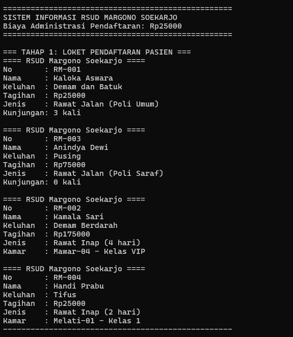
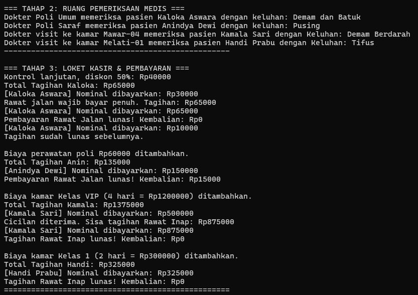

# Sistem Informasi Pelayanan Rumah Sakit
## Identitas 
Nama: Muawanah
NIM: H1D025117
Shift: G
Tema: Rumah Sakit 

## Penjelasan Singkat
Program ini mensimulasikan alur pelayanan pasien di rumah sakit, mulai dari pendaftaran, pemeriksaan, sampai pembayaran tagihan. Pasien dibagi jadi dua jenis, yaitu rawat jalan dan rawat inap, yang cara hitung biaya dan pembayarannya berbeda.

## Isi File
* `Pemeriksaan.java` - Interface untuk pasien yang bisa menjalani pemeriksaan medis.
* `Pembayaran.java` - Interface untuk pasien yang bisa membayar tagihan.
* `Pasien.java` - Abstract class sebagai induk, menyimpan data dasar pasien dan tagihannya.
* `PasienRawatJalan.java` - Subclass untuk pasien rawat jalan. Ada diskon untuk kunjungan lanjutan, dan pembayarannya harus langsung lunas.
* `PasienRawatInap.java` - Subclass untuk pasien rawat inap. Biaya kamar dihitung per hari, dan pembayarannya boleh dicicil.
* `Main.java` - Class utama untuk menjalankan dan menguji semua alurnya.

## Cara Compile dan Menjalankan (Terminal)
**Syarat:** JDK sudah terpasang. Cek dengan `javac -version`.

1. Buka terminal, lalu masuk ke folder proyek:
   ```bash
   cd path/ke/folder/proyek
   ```
2. Compile semua file Java (hasilnya disimpan di folder `out`):
   ```bash
   javac -d out src/*.java
   ```
3. Jalankan programnya:
   ```bash
   java -cp out Main
   ```

## Screenshot Hasil Program



